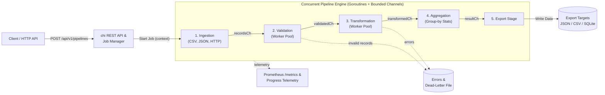

# Concurrent Data Processing Pipeline (Go)

[](https://pkg.go.dev/github.com/anandmindfire/data-processing-pipeline)
[](https://github.com/anandmindfire/data-processing-pipeline/actions/workflows/ci.yml)
[](docs/openapi.json)
[](go.mod)
[](.golangci.yml)
[](Makefile)

A robust, production-oriented, concurrent data processing engine and job management REST service implemented in idiomatic Go. It ingests data from heterogeneous sources (CSV files, JSON files, external HTTP APIs), validates and cleans records against schema and business rules, executes parallel transformations, calculates grouped analytical aggregations, and exports results to storage targets — all while supporting real-time progress tracking, error quarantine, cancellation, and automated tests.

---

## Table of Contents

- [Key Architectural Highlights](#key-architectural-highlights)
- [System Architecture](#system-architecture)
  - [How Data Moves Through the Pipeline](#how-data-moves-through-the-pipeline)
- [Technology Stack](#technology-stack)
- [Project Layout (Clean Architecture)](#project-layout-clean-architecture)
- [Quickstart Guide](#quickstart-guide)
  - [Prerequisites](#prerequisites)
  - [Local Setup via Makefile](#local-setup-via-makefile)
  - [Docker & Container Orchestration](#docker--container-orchestration)
  - [Configuration & Environment Variables](#configuration--environment-variables)
- [API Reference](#api-reference)
  - [Endpoint Overview](#endpoint-overview)
  - [Interactive Swagger UI](#interactive-swagger-ui)
  - [Example Requests & Responses](#example-requests--responses)
- [Concurrency & Fault Tolerance](#concurrency--fault-tolerance)
  - [Bounded Channels & Memory Backpressure](#bounded-channels--memory-backpressure)
  - [Worker Pool Fan-Out / Fan-In](#worker-pool-fan-out--fan-in)
  - [Centralized Error Quarantine & Dead-Letter Handling](#centralized-error-quarantine--dead-letter-handling)
  - [Cooperative Cancellation Hierarchy](#cooperative-cancellation-hierarchy)
  - [Transient HTTP Retries with Exponential Backoff](#transient-http-retries-with-exponential-backoff)
- [Testing & Quality Assurance](#testing--quality-assurance)
- [Continuous Integration (CI/CD)](#continuous-integration-cicd)
- [Contributing & Community](#contributing--community)
- [Documentation Index](#documentation-index)

---

## Key Architectural Highlights

- **Clean Architecture & Separation of Concerns:** Decoupled packages with clear boundaries (`models`, `ingestion`, `validation`, `transformation`, `aggregation`, `export`, `storage`, `jobs`, `pipeline`, `api`, `metrics`, `config`).
- **Bounded Channels & Backpressure:** Pipeline stages communicate strictly via typed, bounded channels (`recordsCh` ➔ `validatedCh` ➔ `transformedCh` ➔ `resultCh`), eliminating unbounded heap growth and providing natural backpressure on disk I/O and network requests.
- **Actor-Style Concurrency (Fan-Out / Fan-In):** Dedicated goroutines per ingestion source stream records in parallel; configurable worker pools parallelize CPU-bound validation and transformation; single-consumer goroutines handle aggregation, export, progress tracking, and error collection without mutex lock contention.
- **Hierarchical Cooperative Cancellation:** Every pipeline job runs under a hierarchical `context.Context` with configurable timeouts. Cancellation via `PATCH /api/v1/pipelines/:id/cancel` propagates instantly to disk readers, HTTP requests, and worker pool loops.
- **Centralized Error Quarantine:** Faulty or corrupted records are isolated with stage and field diagnostic metadata into a centralized error collection over `errorCh`. Valid records continue processing to completion.
- **Dead-Letter Handling:** Configurable destination path (`dead_letter_path`) automatically persists quarantined invalid records and error traces to disk upon completion.
- **Multi-Sink Export Engine:** Pluggable exporter generating indented JSON, RFC 4180 compliant CSV (with deterministic union headers), and transactional SQLite DDL & batch `INSERT` SQL scripts.
- **Reliability & Observability:** Structured logging with standard library `log/slog`, panic recovery middleware, IP-based token-bucket rate limiting, embedded Swagger UI (`/docs`), and Prometheus metrics exposition (`/metrics`).
- **100% Race-Clean & Tested:** Comprehensive unit tests, HTTP mock servers, and end-to-end integration tests passing with zero data races (`go test -race -count=1 ./...`).

---

## System Architecture

The pipeline processes data using an asynchronous, stage-by-stage architecture connected by bounded Go channels. A client submits a job via the REST API; the Job Manager coordinates lifecycle execution under a cancellation context; and independent worker pools process records concurrently with natural backpressure and error quarantine:



### How Data Moves Through the Pipeline

1. **Ingestion (Fan-Out):** Concurrent readers stream data from CSV files, JSON files, or HTTP APIs into a bounded channel (`recordsCh`). HTTP requests automatically retry transient failures up to 3 times with exponential backoff.
2. **Validation (Worker Pool):** Parallel workers validate records against schema and business rules (types, min/max, regex). Invalid rows are diverted to `errorCh` without stopping the pipeline.
3. **Transformation (Worker Pool):** Parallel workers normalize strings, apply mathematical scaling, and set fallback default values.
4. **Aggregation (Fan-In):** A single consumer accumulates group-by statistics (`count`, `sum`, `avg`, `min`, `max`), eliminating lock contention on the hot path.
5. **Export (Multi-Sink):** Valid records and aggregations are exported to JSON, RFC 4180 CSV, or transactional SQLite DDL & batch `INSERT` scripts. Quarantined records can be written to a dead-letter file.

---

## Technology Stack

| Component | Technology | Rationale & Industry Standard Alignment |
| :--- | :--- | :--- |
| **Language** | **Go 1.23+** | Idiomatic Go, memory efficiency, native goroutines, and first-class channel concurrency. |
| **REST API Transport** | **`net/http`** | Go standard library HTTP server with production-grade read/write/idle timeouts. |
| **HTTP Routing** | **`github.com/go-chi/chi/v5`** | Zero-allocation lightweight router supporting URL parameter routing and composable middleware. |
| **Logging** | **`log/slog`** | Standard library structured, contextual JSON/text logging. |
| **Metrics & Telemetry** | **Prometheus** | Industry standard exposition format at `/metrics` (job counters, rate gauges, stage latency distributions). |
| **Documentation** | **OpenAPI 3.0.3 & Swagger UI** | Zero-dependency embedded Swagger UI served at `/docs` with interactive API execution. |
| **Persistence** | **Repository Pattern (`database/sql` Ready)** | Abstracted persistence via `storage.Repository` interface with atomic file and in-memory implementations. |
| **Export Formats** | **JSON, CSV, SQLite SQL** | Indented JSON, RFC 4180 CSV, and transactional SQLite scripts (`CREATE TABLE` + batch `INSERT`). |
| **Containerization** | **Docker & Distroless** | Multi-stage build yielding minimal, secure, non-root Debian 12 distroless container images. |
| **CI / Automation** | **GitHub Actions** | Automated CI pipeline checking formatting, static analysis (`go vet`), race testing, and container builds. |

---

## Project Layout (Clean Architecture)

```
pipeline-system/
├── cmd/
│   └── server/
│       └── main.go                 # Application entry point & graceful shutdown
│
├── configs/
│   ├── config.go                   # Config struct & validation
│   ├── env.go                      # Environment loader (.env & OS env)
│   ├── default.go                  # Default runtime values
│   └── default.json                # Sample JSON configuration
│
├── internal/
│   ├── api/
│   │   ├── controllers/
│   │   │   └── pipeline_controller.go # REST handlers (CRUD, progress, cancel, metrics)
│   │   ├── routes/
│   │   │   └── routes.go           # Route definitions & URL dispatching
│   │   ├── middleware/
│   │   │   ├── logger.go           # Structured HTTP logger (slog)
│   │   │   ├── recovery.go         # Panic recovery middleware
│   │   │   ├── request_id.go       # Unique request tracing (X-Request-ID)
│   │   │   ├── cors.go             # Cross-Origin Resource Sharing
│   │   │   ├── timeout.go          # Request deadline management
│   │   │   └── ratelimit.go        # Per-IP token-bucket rate limiter
│   │   ├── dto/
│   │   │   ├── request/
│   │   │   │   ├── create_pipeline_request.go
│   │   │   │   └── cancel_pipeline_request.go
│   │   │   └── response/
│   │   │       ├── pipeline_response.go
│   │   │       ├── progress_response.go
│   │   │       ├── error_response.go
│   │   │       └── common_response.go
│   │   └── validator/
│   │       └── request_validator.go # Request body & specification validator
│   │
│   ├── services/
│   │   ├── pipeline_service.go     # Application service orchestrator
│   │   ├── job_service.go          # Job lifecycle & concurrency control
│   │   ├── metrics_service.go      # Telemetry & progress calculations
│   │   └── export_service.go       # Dataset export & artifact cleanup
│   │
│   ├── repositories/
│   │   ├── job_repository.go       # Job persistence interface
│   │   ├── error_repository.go     # Error logging interface
│   │   ├── metrics_repository.go   # Observability metrics interface
│   │   └── sqlite/
│   │       └── sqlite_repository.go # SQLite / SQL implementation
│   │
│   ├── pipeline/
│   │   ├── engine.go               # Pipeline orchestrator & executor
│   │   ├── worker_pool.go          # Concurrent worker pool implementation
│   │   ├── channels.go             # Bounded channel mesh topology
│   │   ├── context.go              # Timeout & cancellation context
│   │   ├── coordinator.go          # Stage-to-stage orchestration
│   │   ├── progress_tracker.go     # Real-time progress tracking
│   │   ├── error_collector.go      # Centralized error & dead-letter handler
│   │   └── metrics.go              # Stage latencies & throughput metrics
│   │
│   ├── ingestion/
│   │   ├── reader.go               # Reader interface & orchestrator
│   │   ├── csv_reader.go           # Streaming CSV reader
│   │   ├── json_reader.go          # Streaming JSON & NDJSON reader
│   │   ├── api_reader.go           # Remote HTTP/API reader with retries
│   │   └── factory.go              # Stream parser factory
│   │
│   ├── validation/
│   │   ├── validator.go            # Validator interface & coordination
│   │   ├── schema_validator.go     # Type checking & required fields
│   │   └── business_validator.go   # Min/max thresholds & regex validation
│   │
│   ├── transformation/
│   │   ├── transformer.go          # Transformer interface & engine
│   │   ├── normalize.go            # String casing & trimming
│   │   ├── enrichment.go           # Math scaling & fallback injection
│   │   └── mapping.go              # Field mapping & record cloning
│   │
│   ├── aggregation/
│   │   ├── aggregator.go           # Streaming aggregation engine
│   │   ├── statistics.go           # Count, sum, average, min, max stats
│   │   ├── groupby.go              # Group-by key resolution
│   │   └── summary.go              # Aggregation finalization & formatting
│   │
│   ├── export/
│   │   ├── exporter.go             # Multi-sink export coordinator
│   │   ├── csv_exporter.go         # RFC 4180 CSV serializer
│   │   ├── json_exporter.go        # Formatted JSON serializer
│   │   ├── sqlite_exporter.go      # Transactional SQLite DDL & INSERTs
│   │   └── factory.go              # Exporter target factory
│   │
│   ├── models/
│   │   ├── job.go                  # Job entity & lifecycle states
│   │   ├── record.go               # Record map dictionary
│   │   ├── error.go                # RecordError domain model
│   │   ├── metrics.go              # Metrics & Progress telemetry
│   │   ├── aggregation.go          # Aggregation specifications
│   │   └── pipeline.go             # Pipeline configuration, Source, Rule
│   │
│   ├── database/
│   │   ├── connection.go           # SQL pool & connection manager
│   │   ├── migration.go            # Schema migrations (jobs, errors)
│   │   └── sqlite.go               # SQLite pragmas (WAL) & path helpers
│   │
│   └── bootstrap/
│       ├── app.go                  # Application runtime lifecycle
│       ├── dependency.go           # Dependency injection container
│       └── router.go               # HTTP router & middleware chain
│
├── pkg/
│   ├── logger/                     # Global slog logger initialization
│   ├── errors/                     # Standardized error codes & sentinels
│   ├── response/                   # Reusable HTTP JSON response helpers
│   ├── utils/                      # File, pointer, json, csv, time utils
│   ├── constants/                  # Status, headers, stage constants
│   ├── enums/                      # SourceType, ExportType, JobStatus enums
│   ├── interfaces/                 # Core engine contract interfaces
│   └── types/                      # Common types & pagination helpers
│
├── test/
│   ├── integration/                # End-to-end integration tests
│   ├── unit/                       # Component unit tests
│   ├── mocks/                      # Test mocks and stubs
│   └── testdata/                   # Sample datasets (CSV, JSON)
│
├── docs/                           # Architecture reports & OpenAPI spec
├── samples/                        # Pipeline execution examples
├── scripts/                        # Load testing and benchmark scripts
├── .env.example                    # Environment template
├── Makefile                        # Build, test, and verification tasks
├── Dockerfile                      # Distroless container image
├── docker-compose.yml              # Multi-container local stack
├── go.mod                          # Go module dependencies
└── README.md                       # Comprehensive system documentation
```

---

## Quickstart Guide

### Prerequisites
- **Go 1.23+** (or Docker)
- **Make** (optional, recommended)

### Local Setup via Makefile

```bash
# 1. Format code, run static analysis (go vet), and execute tests with race detector
make check

# 2. Build the optimized server binary
make build

# 3. Start the server locally on :8080
make run
```

### Docker & Container Orchestration

Run the pipeline service in an isolated, multi-stage distroless container:

```bash
# Build the container image
make docker-build

# Launch the container stack with Docker Compose
docker compose up -d

# View live application logs
docker compose logs -f pipeline

# Stop the stack
docker compose down
```

### Configuration & Environment Variables

The server implements 12-factor configuration loading default JSON configurations overridden by environment variables:

| Variable | Type | Default | Description |
| :--- | :--- | :--- | :--- |
| `PORT` / `SERVER_PORT` | string | `8080` | Port for the HTTP server to listen on |
| `ADDR` / `SERVER_ADDR` | string | `:8080` | Host and port address string |
| `DATA_DIR` | string | `data` | Directory where persistent job state is saved |
| `EXPORT_DIR` | string | `exports` | Directory for generated CSV/JSON/SQL output files |
| `MAX_ACTIVE_JOBS` | int | `10` | Maximum number of concurrent running jobs |
| `RATE_LIMIT_RPS` | float | `50.0` | Token bucket refill rate per second per IP |
| `RATE_LIMIT_BURST` | int | `100` | Maximum token bucket burst capacity per IP |
| `DEFAULT_TIMEOUT_SECONDS` | int | `300` | Default job timeout (overridable per job) |
| `LOG_LEVEL` | string | `info` | Logging verbosity (`debug`, `info`, `warn`, `error`) |
| `LOG_FORMAT` | string | `text` | Structured log format (`json` or `text`) |
| `VALIDATION_WORKERS` | int | `4` | Default worker pool size for validation stage |
| `TRANSFORM_WORKERS` | int | `4` | Default worker pool size for transformation stage |
| `BUFFER_SIZE` | int | `64` | Channel capacity for inter-stage buffers |

---

## API Reference

### Endpoint Overview

| Method | Endpoint | Status | Description |
| :--- | :--- | :--- | :--- |
| `POST` | `/api/v1/pipelines` | `202 Accepted` | Submit and trigger a new pipeline execution job |
| `GET` | `/api/v1/pipelines` | `200 OK` | List all submitted pipeline jobs and summary statuses |
| `GET` | `/api/v1/pipelines/{id}` | `200 OK` | Retrieve detailed configuration and metrics for a job |
| `GET` | `/api/v1/pipelines/{id}/progress` | `200 OK` | Poll real-time progress, processed counts, and stage latencies |
| `GET` | `/api/v1/pipelines/{id}/results` | `200 OK` | Retrieve processed records, computed aggregations, and export paths |
| `GET` | `/api/v1/pipelines/{id}/errors` | `200 OK` | Inspect quarantined errors and failed record details |
| `PATCH`| `/api/v1/pipelines/{id}/cancel` | `202 Accepted` | Trigger cooperative cancellation on a running job |
| `DELETE`| `/api/v1/pipelines/{id}` | `204 No Content` | Delete a finished job, state entries, and export files |
| `GET` | `/docs` | `200 OK` | Interactive embedded Swagger UI API documentation |
| `GET` | `/docs/openapi.json` | `200 OK` | OpenAPI 3.0.3 specification JSON |
| `GET` | `/metrics` | `200 OK` | Prometheus text exposition metrics endpoint |
| `GET` | `/healthz` | `200 OK` | Liveness and readiness health probe |

### Interactive Swagger UI

Open your browser to explore and execute API calls directly:
```
http://localhost:8080/docs
```

---

### Example Requests & Responses

#### 1. Submit a Pipeline Job
```bash
curl -sS -X POST http://localhost:8080/api/v1/pipelines \
  -H "Content-Type: application/json" \
  -d @samples/job.json
```

**Response (`202 Accepted`):**
```json
{
  "id": "20261104T100000.000000000-001",
  "status": "PENDING",
  "created_at": "2026-11-04T10:00:00Z"
}
```

#### 2. Submit a Mixed Source Job (CSV + JSON + HTTP REST API)
```bash
curl -sS -X POST http://localhost:8080/api/v1/pipelines \
  -H "Content-Type: application/json" \
  -d @samples/mixed_job.json
```

#### 3. Poll Real-Time Progress & Latencies
```bash
curl -sS http://localhost:8080/api/v1/pipelines/<JOB_ID>/progress
```

**Response (`200 OK`):**
```json
{
  "job_id": "20261104T100000.000000000-001",
  "status": "RUNNING",
  "percent_complete": 85.71,
  "processed": 6,
  "discovered": 7,
  "pending": 1,
  "valid": 6,
  "rejected": 1,
  "error_count": 1,
  "records_per_second": 3.82,
  "stage_latency_ns": {
    "validation": 420000,
    "transformation": 310000,
    "aggregation": 152000
  }
}
```

#### 4. Retrieve Computed Aggregations & Export Details
```bash
curl -sS http://localhost:8080/api/v1/pipelines/<JOB_ID>/results
```

**Response (`200 OK`):**
```json
{
  "job_id": "20261104T100000.000000000-001",
  "status": "COMPLETED",
  "records": [
    {"department": "engineering", "name": "Alice", "salary": 120000},
    {"department": "sales", "name": "Bob", "salary": 90000}
  ],
  "aggregations": {
    "employee_count": {"engineering": 3, "sales": 3},
    "salary_total": {"engineering": 365000, "sales": 265000},
    "salary_average": {"engineering": 121666.67, "sales": 88333.33}
  },
  "export_path": "exports/employees.json"
}
```

#### 5. Inspect Quarantined Errors
```bash
curl -sS http://localhost:8080/api/v1/pipelines/<JOB_ID>/errors
```

**Response (`200 OK`):**
```json
{
  "job_id": "20261104T100000.000000000-001",
  "errors": [
    {
      "source": "employees-csv",
      "index": 4,
      "stage": "validation",
      "message": "field \"salary\": invalid number \"invalid\"",
      "record": {
        "department": "Engineering",
        "name": "Eve",
        "salary": "invalid"
      },
      "at": "2026-11-04T10:00:00.120Z"
    }
  ]
}
```

#### 6. Cancel a Running Job
```bash
curl -sS -X PATCH http://localhost:8080/api/v1/pipelines/<JOB_ID>/cancel
```

---

## Concurrency & Fault Tolerance

### Bounded Channels & Memory Backpressure
All inter-stage communication occurs across typed, bounded Go channels configured by `BufferSize`. When worker stages experience CPU spikes or downstream consumers slow down, upstream stages automatically block on send, creating natural backpressure. Memory consumption remains strictly bounded regardless of dataset scale.

### Worker Pool Fan-Out / Fan-In
Validation and Transformation execute concurrently using parameterized worker pools. Workers consume records from input channels, process them concurrently, and forward valid items downstream. Aggregation employs single-consumer fan-in, ensuring thread-safe accumulator updates without mutex locking overhead on the critical path.

### Centralized Error Quarantine & Dead-Letter Handling
A single corrupted record (e.g. malformed type, regex mismatch, or numeric out-of-bounds) never aborts pipeline execution. Bad rows are decorated with stage diagnostics and emitted to `errorCh`. When `dead_letter_path` is specified in the job configuration, the quarantined records and stack metadata are exported to disk automatically.

### Cooperative Cancellation Hierarchy
Every job is bound to a hierarchical context:
```go
ctx, cancel := context.WithTimeout(parent, time.Duration(cfg.TimeoutSeconds)*time.Second)
defer cancel()
```
Cancellation triggers immediately via API (`PATCH /api/v1/pipelines/:id/cancel`) or timeout. Readers, HTTP requests (`http.NewRequestWithContext`), and worker pool `select` blocks terminate cooperatively, releasing file descriptors and goroutines cleanly. Terminal states are guaranteed persistence using dedicated non-cancelled contexts.

### Transient HTTP Retries with Exponential Backoff
Remote HTTP sources incorporate automatic retry logic for transient failures (e.g., connection resets or 5xx HTTP responses):
- Maximum 3 attempts with exponential backoff ($50\text{ms} \rightarrow 100\text{ms} \rightarrow 200\text{ms}$).
- Client errors (4xx) fail immediately without wasteful retries.
- Respects `ctx.Done()` during backoff intervals to allow cancellation.

---

## Testing & Quality Assurance

The codebase includes comprehensive test suites spanning parsers, validators, transformers, aggregators, exporters, mock transports, API handlers, and end-to-end integration flows:

```bash
# Run all tests across packages
go test -v ./...

# Verify zero race conditions using Go's race detector
go test -race -count=1 ./...

# Run static analysis
go vet ./...

# Run complete verification suite (fmt + vet + race)
make check
```

---

## Continuous Integration (CI/CD)

Automated continuous integration runs on every push and pull request via [`.github/workflows/ci.yml`](.github/workflows/ci.yml):
1. **Formatting & Static Analysis:** Checks `gofmt` compliance and executes `go vet` and `golangci-lint`.
2. **Race Condition Tests:** Runs `go test -race -v -covermode=atomic ./...` across all packages with zero data races.
3. **Binary & Container Build Verification:** Compiles `bin/pipeline-server` and builds the multi-stage distroless Docker image.

---

## Contributing & Community

We welcome contributions to the Data Processing Pipeline! Please review our community guides:
- **[Contributing Guide](CONTRIBUTING.md):** Complete developer workflow, coding standards, branching strategy, testing guidelines, and PR checklist.
- **[Code of Conduct](CODE_OF_CONDUCT.md):** Contributor Covenant v2.1 community behavior standards.
- **[Pull Request Template](.github/pull_request_template.md):** Standardized pull request submission template.
- **[Issue Templates](.github/ISSUE_TEMPLATE/):** Bug reports and feature request templates.

---

## Documentation Index

- **[Design Report (<= 1 Page)](docs/design-report.md):** Executive report summarizing design choices, the concurrency model, channel lifecycle ownership, and engineering trade-offs.
- **[Production Readiness Analysis](docs/production-readiness.md):** In-depth engineering blueprint contrasting current codebase achievements with enterprise cloud requirements (PostgreSQL migrations, S3/GCS object storage, durable queues, OpenTelemetry, and container hardening).
- **[OpenAPI 3.0.3 Specification](docs/openapi.json):** Full OpenAPI specification describing all REST endpoints, parameters, schemas, and responses.
- **[Contributing Guidelines](CONTRIBUTING.md):** Developer setup, engineering standards, and PR process.
- **[Code of Conduct](CODE_OF_CONDUCT.md):** Community engagement standards.
