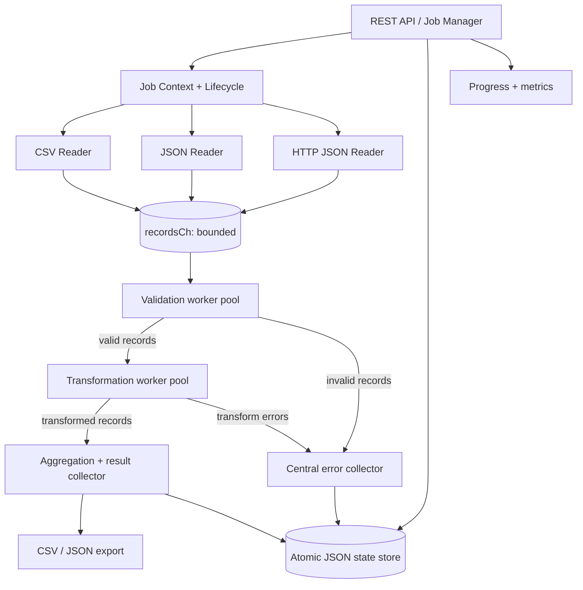

# Concurrent Data Processing Pipeline (Go)

A production-oriented reference implementation of a configurable, concurrent data-processing service. It ingests CSV/JSON files and JSON HTTP APIs, validates and transforms records, computes group aggregations, exports CSV/JSON, and exposes job lifecycle and observability endpoints.

## Highlights

- Go pipeline stages connected by typed, bounded channels.
- One ingestion goroutine per source; configurable validation and transformation worker pools.
- Context propagation, per-job timeout, and cancellation endpoint.
- Invalid records are quarantined in a persistent error collection while valid records continue.
- Count, sum, and average aggregations with group-by support.
- Atomic JSON state-file persistence for jobs, processed records, and errors; configurable CSV/JSON result exports.
- Progress counters, throughput, timestamps, and stage latency metrics.
- Standard-library HTTP server, no third-party runtime dependencies.

> Persistence choice: this implementation uses an atomic JSON state file rather than introducing a database driver. The assignment permits database **and/or** file persistence. For multi-instance production deployments, replace `internal/storage.Store` with a transactional PostgreSQL repository and object storage for large result sets.

## Architecture



Each stage owns a single responsibility. The ingestion coordinator closes `raw` after all source goroutines finish; the validation coordinator closes `valid` after all validation workers finish; the transformation coordinator closes `transformed` after all transform workers finish. This ownership prevents send-on-closed-channel races. The aggregation/result collector is a single fan-in consumer, so aggregate maps do not require concurrent writes.

## Requirements

- Go 1.23 or newer
- No external Go modules required

## Run locally

```bash
git clone <repository-url>
cd data-processing-pipeline
go test ./...
go test -race ./...
go run ./cmd/server
```

The server listens on `:8080` by default. Override configuration with environment variables:

```bash
ADDR=:9000 DATA_DIR=./runtime-data go run ./cmd/server
```

`DATA_DIR` stores `state.json`; exports are written to the paths specified by each job. Relative paths are resolved from the server's working directory.

## Create a job

The sample job reads one local CSV and one local JSON file concurrently, normalizes departments, validates numeric salary values, computes group aggregates, and exports both CSV and JSON.

```bash
curl -sS -X POST http://localhost:8080/api/v1/pipelines \
  -H 'Content-Type: application/json' \
  --data-binary @samples/job.json
```

Example job specification:

```json
{
  "sources": [
    {"type":"csv","name":"employees","path":"samples/input.csv"},
    {"type":"json","name":"extra-employees","path":"samples/input.json"},
    {"type":"http","name":"remote-posts","url":"https://jsonplaceholder.typicode.com/posts","format":"json"}
  ],
  "rules": [
    {"field":"name","type":"string","required":true,"normalize":"trim"},
    {"field":"salary","type":"number","required":true,"min":0}
  ],
  "aggregations": [
    {"group_by":"department","field":"salary","operation":"sum","name":"salary_by_department"},
    {"group_by":"department","field":"salary","operation":"avg","name":"average_salary"},
    {"group_by":"department","field":"salary","operation":"count","name":"employees_by_department"}
  ],
  "exports": [
    {"type":"json","path":"exports/result.json"},
    {"type":"csv","path":"exports/result.csv"}
  ],
  "validation_workers": 4,
  "transform_workers": 4,
  "buffer_size": 128,
  "timeout_seconds": 300,
  "max_records": 10000
}
```

Source types: `csv`, `json`, and `http` (alias `api`). File sources require `path`; HTTP sources require `url` and accept optional `headers`. HTTP responses and JSON files must contain either a JSON object or an array of objects. CSV uses the first row as column names. For HTTP sources, `format` defaults to `json`.

Rule options: `required`, `type` (`string` or `number`), numeric `min`/`max`, `normalize` (`trim`, `lower`, `upper`), and numeric `multiply`. Transformations are intentionally declarative and limited to these safe built-ins; do not accept arbitrary user-supplied code in a pipeline specification.

Aggregation operations: `count`, `sum`, `avg`/`average`. `group_by` is optional; without it the group is `_all`. `field` is required by the current spec, including count.

## API reference

| Method | Endpoint | Purpose |
|---|---|---|
| POST | `/api/v1/pipelines` | Validate a job spec, persist a pending job, and start it asynchronously (202) |
| GET | `/api/v1/pipelines` | List jobs |
| GET | `/api/v1/pipelines/{id}` | Get job details |
| GET | `/api/v1/pipelines/{id}/progress` | Get counters, percent complete, throughput, timestamps, and stage latency |
| GET | `/api/v1/pipelines/{id}/results` | Get processed records, aggregates, and export path |
| GET | `/api/v1/pipelines/{id}/errors` | Get ingestion/validation/transformation/export errors and failed record payloads |
| PATCH | `/api/v1/pipelines/{id}/cancel` | Request cancellation of a running job |
| DELETE | `/api/v1/pipelines/{id}` | Delete a non-running job and its persisted records/errors (does not remove external export files) |
| GET | `/healthz` | Liveness check |
| GET | `/metrics` | Basic Prometheus text metrics |

Example follow-up requests:

```bash
# List jobs
curl http://localhost:8080/api/v1/pipelines

# Replace JOB_ID with the id returned by POST
curl http://localhost:8080/api/v1/pipelines/JOB_ID/progress
curl http://localhost:8080/api/v1/pipelines/JOB_ID/results
curl http://localhost:8080/api/v1/pipelines/JOB_ID/errors
curl -X PATCH http://localhost:8080/api/v1/pipelines/JOB_ID/cancel
curl -X DELETE http://localhost:8080/api/v1/pipelines/JOB_ID
curl http://localhost:8080/metrics
```

Example progress response:

```json
{
  "job_id":"20261103T083000.123456789",
  "status":"COMPLETED",
  "percent_complete":100,
  "processed":6,
  "discovered":7,
  "pending":0,
  "valid":6,
  "rejected":1,
  "error_count":1,
  "records_per_second":1200.5,
  "stage_latency_ns":{"transform":23000}
}
```

The example is illustrative; actual IDs, timestamps, counters, and rates depend on the run. Percent complete is terminal-state aware; during execution it is based on records discovered and accounted for as processed or rejected. A source-level failure is exposed in the errors endpoint. If every source fails before yielding a record, the job is marked failed.

## Testing

```bash
go test ./...
go test -race ./...
go vet ./...
```

Tests cover required/type/range validation, normalization and numeric conversion, end-to-end ingestion through export and aggregation, cancellation, and HTTP job creation/retrieval.

## Operational and design notes

- **Backpressure:** every stage channel is bounded by `buffer_size`; slow downstream stages naturally slow upstream senders.
- **Concurrency:** source readers fan out independently. Validation and transformation each use configurable worker pools. A single fan-in collector owns aggregation state and result persistence.
- **Cancellation:** the job context reaches file iteration and HTTP request creation; workers select on `ctx.Done()` when sending downstream. HTTP calls also have a client timeout.
- **Error policy:** bad records are recorded with source, row/index, stage, message, payload, and timestamp; processing continues. Infrastructure failures are recorded separately.
- **Progress:** discovered, processed, valid, rejected, exported, and error counts are distinct. `processed` means successfully transformed and accepted; `exported` is set after configured exports complete.
- **Durability trade-off:** the JSON store writes a complete state snapshot atomically through a temporary file and rename. This is simple and dependency-free, but write amplification and single-process locking make it unsuitable for high-volume or multi-replica workloads. A database repository is the next production step.
- **Export trade-off:** CSV header order is sorted for deterministic output. Heterogeneous records use the first record's keys as CSV columns; JSON preserves all record fields.
- **Security:** the sample service is intended for trusted/internal use. Before exposing it publicly, add authentication/authorization, source URL allowlists/SSRF protection, path sandboxing, request/job quotas, redaction of secrets in headers/errors, and retention controls.
