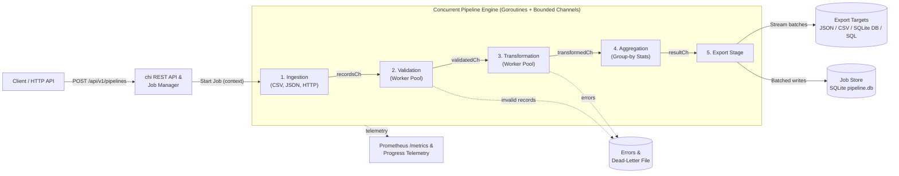

# Concurrent Data Processing Pipeline (Go)

[](https://pkg.go.dev/github.com/anandmindfire/data-processing-pipeline)
[](https://github.com/anandmindfire/Data_Processing_Pipeline/actions/workflows/ci.yml)
[](api/openapi.json)
[](go.mod)
[](.golangci.yml)
[](Makefile)

A robust, production-oriented, concurrent data processing engine and job management REST service implemented in idiomatic Go. It ingests data from heterogeneous sources (CSV files, JSON files, external HTTP APIs), validates and cleans records against schema and business rules, executes parallel transformations, calculates grouped analytical aggregations, and exports results to storage targets — all while supporting real-time progress tracking, error quarantine, cancellation, and automated tests.

---

## Table of Contents

- [Key Architectural Highlights](#key-architectural-highlights)
- [System Architecture](#system-architecture)
  - [How Data Moves Through the Pipeline](#how-data-moves-through-the-pipeline)
- [Technology Stack](#technology-stack)
- [Project Layout](#project-layout)
- [Quickstart Guide](#quickstart-guide)
  - [Prerequisites](#prerequisites)
  - [Local Setup via Makefile](#local-setup-via-makefile)
  - [Docker & Container Orchestration](#docker--container-orchestration)
  - [Configuration & Environment Variables](#configuration--environment-variables)
- [API Reference](#api-reference)
  - [Endpoint Overview](#endpoint-overview)
  - [Interactive Swagger UI](#interactive-swagger-ui)
  - [Example Requests & Responses](#example-requests--responses)
- [Concurrency & Fault Tolerance](#concurrency--fault-tolerance)
  - [Bounded Channels & Memory Backpressure](#bounded-channels--memory-backpressure)
  - [Worker Pool Fan-Out / Fan-In](#worker-pool-fan-out--fan-in)
  - [Centralized Error Quarantine & Dead-Letter Handling](#centralized-error-quarantine--dead-letter-handling)
  - [Cooperative Cancellation Hierarchy](#cooperative-cancellation-hierarchy)
  - [Transient HTTP Retries with Exponential Backoff](#transient-http-retries-with-exponential-backoff)
- [API Keys](#api-keys)
- [Scaling to Multiple Replicas](#scaling-to-multiple-replicas)
- [Security](#security)
- [Testing & Quality Assurance](#testing--quality-assurance)
- [Continuous Integration (CI/CD)](#continuous-integration-cicd)
- [Contributing & Community](#contributing--community)
- [Documentation Index](#documentation-index)

---

## Key Architectural Highlights

- **Clean Architecture & Separation of Concerns:** Decoupled packages with clear boundaries (`models`, `ingestion`, `validation`, `transformation`, `aggregation`, `export`, `storage`, `services`, `pipeline`, `api`, `metrics`, `config`). See [Project Layout](#project-layout).
- **Bounded Channels & Backpressure:** Pipeline stages communicate strictly via typed, bounded channels (`recordsCh` ➔ `validatedCh` ➔ `transformedCh` ➔ `resultCh`), eliminating unbounded heap growth and providing natural backpressure on disk I/O and network requests.
- **Actor-Style Concurrency (Fan-Out / Fan-In):** Dedicated goroutines per ingestion source stream records in parallel; configurable worker pools parallelize CPU-bound validation and transformation; single-consumer goroutines handle aggregation, export, progress tracking, and error collection without mutex lock contention.
- **Hierarchical Cooperative Cancellation:** Every pipeline job runs under a hierarchical `context.Context` with configurable timeouts. Cancellation via `PATCH /api/v1/pipelines/:id/cancel` propagates instantly to disk readers, HTTP requests, and worker pool loops.
- **Centralized Error Quarantine:** Faulty or corrupted records are isolated with stage and field diagnostic metadata into a centralized error collection over `errorCh`. Valid records continue processing to completion.
- **Dead-Letter Handling:** Configurable destination path (`dlq_path`) persists quarantined invalid records and error traces to disk upon completion.
- **Streaming Multi-Sink Export:** A dedicated export goroutine streams record batches to every target while the job runs: JSON, RFC 4180 CSV (deterministic union headers), a real **SQLite database** (`records` + `aggregations` tables, via `database/sql`), and a portable SQL dump. Files are written to `<path>.part` and atomically renamed only when the job completes, so cancelled or failed runs never publish partial output.
- **Durable Job Store, single node or multi-replica:** Jobs, records and errors are persisted with batched multi-row writes and versioned migrations, in embedded SQLite (`DATA_DIR/pipeline.db`, default) or in **PostgreSQL** (`DATABASE_URL`). With PostgreSQL several replicas share the store: any replica serves any job, cancellation works across replicas, and jobs of a crashed replica are failed after `JOB_LEASE`.
- **Expiring API Keys:** The admin key (`API_KEY`) issues, lists and revokes managed keys with an expiry (`/api/v1/auth/keys`). Generated keys can call every pipeline endpoint; only hashes are stored.
- **Live Progress:** The progress tracker persists a metrics snapshot every 500 ms while a job runs, so `GET /progress` reports real-time counts, throughput, and stage latencies.
- **Secure by Default:** Local source paths are sandboxed to `INPUT_DIRS`, every export/DLQ path to `EXPORT_DIR` (symlink-aware); HTTP sources are SSRF-protected at dial time (private, loopback, link-local and metadata ranges blocked, redirects re-validated); per-job worker, buffer, batch, timeout, and source limits are enforced at submission.
- **Lifecycle Safety:** `SIGTERM` stops intake, cancels running jobs (recorded as `CANCELLED: server shutting down`), and drains them before exit; jobs interrupted by a crash are marked `FAILED` on the next start.
- **Reliability & Observability:** Structured logging with standard library `log/slog`, panic recovery middleware, IP-based token-bucket rate limiting, embedded Swagger UI (`/docs`), and Prometheus metrics exposition (`/metrics`).
- **100% Race-Clean & Tested:** Comprehensive unit tests, HTTP mock servers, and end-to-end integration tests passing with zero data races (`go test -race -count=1 ./...`).

---

## System Architecture

The pipeline processes data using an asynchronous, stage-by-stage architecture connected by bounded Go channels. A client submits a job via the REST API; the Job Manager coordinates lifecycle execution under a cancellation context; and independent worker pools process records concurrently with natural backpressure and error quarantine:



### How Data Moves Through the Pipeline

1. **Ingestion (Fan-Out):** Concurrent readers stream data from CSV files, JSON files, or HTTP APIs into a bounded channel (`recordsCh`). HTTP requests automatically retry transient failures up to 3 times with exponential backoff.
2. **Validation (Worker Pool):** Parallel workers validate records against schema and business rules (types, min/max, regex). Invalid rows are diverted to `errorCh` without stopping the pipeline.
3. **Transformation (Worker Pool):** Parallel workers normalize strings, apply mathematical scaling, and set fallback default values.
4. **Aggregation (Fan-In, optionally partitioned):** By default one goroutine accumulates group-by statistics (`count`, `sum`, `avg`, `min`, `max`) without locks. With `aggregation_workers > 1`, each worker owns a partial aggregator and sends it on a partials channel when done; one merger goroutine folds the partials into the final result (all operations are associative, so the result is identical).
5. **Export (Streaming, Multi-Sink):** A single export goroutine batches records (`batch_size`, default 500), persists each batch to the job store in one transaction, and streams it to every export target. Aggregations are written into the SQLite database / SQL dump, and as a `<name>.aggregations.json` sidecar for JSON/CSV exports. Quarantined records can be written to a dead-letter file (`dlq_path`).
6. **Side channels:** `errorCh` feeds one error-collector goroutine (batched persistence); `progressCh` feeds one progress-tracker goroutine that owns the job metrics and persists live snapshots.

---

## Technology Stack

| Component | Technology | Rationale & Industry Standard Alignment |
| :--- | :--- | :--- |
| **Language** | **Go 1.26 (toolchain pinned in `go.mod`)** | Idiomatic Go, memory efficiency, native goroutines, and first-class channel concurrency. |
| **REST API Transport** | **`net/http`** | Go standard library HTTP server with production-grade read/write/idle timeouts. |
| **HTTP Routing** | **`github.com/go-chi/chi/v5`** | Zero-allocation lightweight router supporting URL parameter routing and composable middleware. |
| **Logging** | **`log/slog`** | Standard library structured, contextual JSON/text logging. |
| **Metrics & Telemetry** | **Prometheus** | Industry standard exposition format at `/metrics` (job counters, rate gauges, stage latency distributions). |
| **Documentation** | **OpenAPI 3.0.3 & Swagger UI** | Zero-dependency embedded Swagger UI served at `/docs` with interactive API execution. |
| **Persistence** | **`database/sql` with SQLite (`modernc.org/sqlite`) or PostgreSQL (`pgx`)** | One `SQLRepository` with two dialects; in-memory implementation for tests. Pure Go drivers, so the binary stays static. |
| **Export Formats** | **JSON, CSV, SQLite DB, SQL dump** | Streamed JSON array, RFC 4180 CSV, SQLite database file (`records`, `aggregations`), and portable SQL dump. |
| **Containerization** | **Docker & Distroless** | Multi-stage build yielding minimal, secure, non-root Debian 12 distroless container images. |
| **CI / Automation** | **GitHub Actions** | golangci-lint (incl. gosec), race tests with a coverage gate, govulncheck, container smoke test, and Trivy image scan; actions pinned to commit SHAs; Dependabot updates. |

---

## Project Layout

The layout follows the common Go application convention: `cmd/` for entry points, `internal/`
for all application code (not importable by other modules), and `api/` for the public contract.
Dependencies point inward: `handlers → services → pipeline → stages → models`; only
`bootstrap` wires concrete implementations together.

```
.
├── api/                         # Public API contract
│   ├── openapi.json             #   OpenAPI 3 spec (served at /docs/openapi.json)
│   └── spec.go                  #   go:embed of the spec
├── cmd/server/                  # Entry point: flags, signals, graceful shutdown, --healthcheck
├── internal/
│   ├── bootstrap/               # Composition root: config → store → pipeline → services → router
│   ├── config/                  # Defaults, JSON file, .env and environment overrides, validation
│   ├── buildinfo/               # Version/commit injected with -ldflags
│   ├── api/
│   │   ├── handlers/            #   HTTP handlers: pipelines, probes (/healthz, /readyz), docs
│   │   ├── middleware/          #   request ID, recovery, security headers, logging, CORS,
│   │   │                        #   rate limit (trusted-proxy aware), API key auth, timeout
│   │   ├── routes/              #   /api/v1/pipelines route table
│   │   ├── validator/           #   job-spec validation, limits, path sandboxing
│   │   ├── dto/{request,response}/ # wire formats
│   │   └── respond/             #   JSON response helpers
│   ├── services/                # Use cases: job lifecycle, replica coordination, results, retention
│   ├── auth/                    # Expiring API keys: issue, verify (cached), revoke, purge
│   ├── pipeline/                # Engine: channels, worker pools, aggregation fan-in, export stage,
│   │                            #   progress tracker, error collector, DLQ
│   ├── ingestion/               # CSV / JSON / NDJSON / HTTP readers, records_path, size limits,
│   │                            #   SSRF-safe HTTP client with retries
│   ├── validation/              # Schema & business rules
│   ├── transformation/          # Type conversion, normalization, scaling, defaults, rename
│   ├── aggregation/             # count/sum/avg/min/max, group-by, mergeable partials
│   ├── export/                  # Streaming sinks: JSON, CSV, SQLite DB, SQL dump (atomic publish)
│   ├── storage/                 # Repository contract; SQL repository (SQLite + PostgreSQL), memory (tests)
│   ├── metrics/                 # Prometheus collector & exposition
│   └── models/                  # Domain types: JobSpec, Job, Record, Metrics, RecordError
├── test/integration/            # End-to-end tests through the real HTTP router
├── samples/                     # Sample inputs, job specs, and recorded API responses
├── scripts/                     # smoke_test.sh (container E2E), load_test.sh, run_pipeline.sh
├── docs/                        # Design report and production-readiness notes
├── .github/                     # CI workflow, Dependabot, issue/PR templates
├── Dockerfile                   # Multi-stage, static, distroless, non-root image
├── docker-compose.yml           # Single-instance stack with hardened container settings
├── docker-compose.postgres.yml  # Override: PostgreSQL + a second replica
├── Makefile                     # build, test, cover, lint, vuln, docker targets (`make help`)
└── SECURITY.md                  # Security model and vulnerability reporting
```

Unit tests live next to the code they test (`*_test.go`); `test/integration` holds the
cross-package end-to-end tests.

---

## Quickstart Guide

### Prerequisites
- **Go 1.26** (the exact patched toolchain is pinned in `go.mod` and fetched automatically), or Docker
- **Make** (optional, recommended); `make tools` installs golangci-lint and govulncheck

### Local Setup via Makefile

```bash
# 1. Format code, run static analysis (go vet), and execute tests with race detector
make check

# 2. Build the optimized server binary
make build

# 3. Start the server locally on :8080
make run
```

### Docker & Container Orchestration

Run the pipeline service in an isolated, multi-stage distroless container:

```bash
# Build the container image
make docker-build

# Launch the container stack with Docker Compose (host port: ${PORT:-8080})
docker compose up -d

# Put your own input files in ./inputs (mounted read-only at /app/inputs);
# job specs reference them as "/app/inputs/<file>" or the bundled "samples/<file>".

# View live application logs
docker compose logs -f pipeline

# Stop the stack
docker compose down
```

### Configuration & Environment Variables

The server implements 12-factor configuration loading default JSON configurations overridden by environment variables:

| Variable | Type | Default | Description |
| :--- | :--- | :--- | :--- |
| `PORT` / `SERVER_PORT` | string | `8080` | Port for the HTTP server to listen on |
| `ADDR` / `SERVER_ADDR` | string | `:8080` | Host and port address string |
| `API_BASE_URL` / `BASE_URL` | string | `http://localhost:8080` | Public base URL shown in the API docs |
| `HEALTHCHECK_URL` | string | local listener | Override the URL probed by `--healthcheck` |
| `API_BASE_PATH` / `API_PREFIX` | string | `/api/v1` | Routing prefix path for pipeline REST endpoints |
| `API_KEY` | string | `""` | API key(s) for `X-API-Key` / `Bearer` auth; ≥ 16 chars, comma-separated for rotation. Empty = unauthenticated (local only) |
| `DATA_DIR` | string | `data` | Directory holding the SQLite job store (`pipeline.db`) |
| `EXPORT_DIR` | string | `exports` | Export sandbox: every export and DLQ path must be inside it |
| `INPUT_DIRS` | list | `samples` | Comma-separated directories local file sources may read from |
| `ALLOW_PRIVATE_SOURCES` | bool | `false` | Allow HTTP sources on private/loopback networks (dev only) |
| `MAX_WORKERS_PER_STAGE` | int | `64` | Upper bound for `validation_workers` / `transform_workers` |
| `MAX_BUFFER_SIZE` / `MAX_BATCH_SIZE` | int | `10000` | Upper bounds for `buffer_size` / `batch_size` |
| `MAX_JOB_TIMEOUT_SECONDS` | int | `3600` | Upper bound for `timeout_seconds` |
| `MAX_SOURCES_PER_JOB` / `MAX_EXPORTS_PER_JOB` | int | `16` / `8` | Spec size limits |
| `SHUTDOWN_TIMEOUT` | duration | `25s` | Time to cancel and drain running jobs on `SIGTERM` |
| `REQUEST_TIMEOUT` | duration | `30s` | Deadline for each API request |
| `TRUSTED_PROXIES` | list | *(none)* | CIDRs of reverse proxies whose `X-Forwarded-For` is trusted for client IPs |
| `CORS_ALLOWED_ORIGINS` | list | *(none)* | Browser origins allowed by CORS (`*` = any; none = same-origin only) |
| `METRICS_PUBLIC` | bool | `false` | Serve `/metrics` without the API key |
| `DOCS_ENABLED` | bool | `true` | Serve the Swagger UI and OpenAPI spec |
| `MAX_SOURCE_BYTES` | int | `1073741824` | Maximum bytes read from one source (file or HTTP body) |
| `MAX_AGGREGATION_WORKERS` | int | `16` | Upper bound for `aggregation_workers` |
| `JOB_RETENTION` | duration | `168h` | Finished jobs and their exports (and expired/revoked API keys) older than this are purged hourly (`0` keeps forever) |
| `DATABASE_URL` | string | *(empty)* | `postgres://…` enables the shared PostgreSQL store for multiple replicas; empty = SQLite in `DATA_DIR` |
| `DB_MAX_OPEN_CONNS` / `DB_MAX_IDLE_CONNS` / `DB_CONN_MAX_LIFETIME` | int / int / duration | `20` / `10` / `30m` | PostgreSQL connection pool |
| `INSTANCE_ID` | string | hostname-random | Replica identity recorded as the job `owner` |
| `JOB_LEASE` | duration | `30s` | A replica that stops heartbeating for this long has its running jobs failed by the others |
| `API_KEY_DEFAULT_TTL` / `API_KEY_MAX_TTL` | duration | `720h` / `8760h` | Default and maximum lifetime of generated API keys |
| `MAX_API_KEYS` | int | `100` | Maximum number of active generated keys |
| `READ_TIMEOUT` / `WRITE_TIMEOUT` / `IDLE_TIMEOUT` | duration | `15s` / `30s` / `60s` | HTTP server timeouts |
| `MAX_ACTIVE_JOBS` | int | `10` | Maximum number of concurrent running jobs |
| `RATE_LIMIT_RPS` | float | `50.0` | Token bucket refill rate per second per IP |
| `RATE_LIMIT_BURST` | int | `100` | Maximum token bucket burst capacity per IP |
| `DEFAULT_TIMEOUT_SECONDS` | int | `300` | Default job timeout (overridable per job) |
| `LOG_LEVEL` | string | `info` | Logging verbosity (`debug`, `info`, `warn`, `error`) |
| `LOG_FORMAT` | string | `text` | Structured log format (`json` or `text`) |
| `DEFAULT_VALIDATION_WORKERS` | int | `4` | Validation pool size when a job does not set one |
| `DEFAULT_TRANSFORM_WORKERS` | int | `4` | Transform pool size when a job does not set one |
| `DEFAULT_BUFFER_SIZE` | int | `64` | Channel capacity when a job does not set one |

Server defaults are applied at submission, so `GET /pipelines/{id}` shows the effective values a job ran with.

---

## API Reference

### Endpoint Overview

| Method | Endpoint | Status | Description |
| :--- | :--- | :--- | :--- |
| `POST` | `/api/v1/pipelines` | `202 Accepted` | Submit and trigger a new pipeline execution job |
| `GET` | `/api/v1/pipelines` | `200 OK` | List jobs, newest first (`?status=&limit=&offset=`, total in `X-Total-Count`) |
| `GET` | `/api/v1/pipelines/{id}` | `200 OK` | Retrieve detailed configuration and metrics for a job |
| `GET` | `/api/v1/pipelines/{id}/progress` | `200 OK` | Poll real-time progress, processed counts, and stage latencies |
| `GET` | `/api/v1/pipelines/{id}/results` | `200 OK` | Aggregations, export paths, and a page of records (`?limit=&offset=`, default 100) |
| `GET` | `/api/v1/pipelines/{id}/errors` | `200 OK` | A page of errors and failed records (`?limit=&offset=`, default 100) |
| `PATCH`| `/api/v1/pipelines/{id}/cancel` | `202 Accepted` | Trigger cooperative cancellation on a running job |
| `DELETE`| `/api/v1/pipelines/{id}` | `204 No Content` | Delete a finished job, state entries, and export files |
| `GET` | `/docs` | `200 OK` | Swagger UI (disable with `DOCS_ENABLED=false`) |
| `GET` | `/docs/openapi.json` | `200 OK` | OpenAPI 3 specification |
| `GET` | `/metrics` | `200 OK` | Prometheus metrics (requires the API key unless `METRICS_PUBLIC=true`) |
| `GET` | `/healthz` | `200 OK` | Liveness probe with build info (never checks dependencies) |
| `GET` | `/readyz` | `200` / `503` | Readiness probe: job store reachable and not shutting down |
| `POST` | `/api/v1/auth/keys` | `201 Created` | **Admin:** generate an expiring API key (secret returned once) |
| `GET` | `/api/v1/auth/keys` | `200 OK` | **Admin:** list keys with status (`active`/`expired`/`revoked`), never secrets |
| `DELETE` | `/api/v1/auth/keys/{keyID}` | `204 No Content` | **Admin:** revoke a key |

When `API_KEY` is set, every endpoint except the probes and docs requires `X-API-Key: <key>` or
`Authorization: Bearer <key>`.

### Interactive Swagger UI

Open your browser to explore and execute API calls directly:
```
http://localhost:8080/docs
```

---

### Example Requests & Responses

#### 1. Submit a Pipeline Job
```bash
curl -sS -X POST http://localhost:8080/api/v1/pipelines \
  -H "Content-Type: application/json" \
  -d @samples/job.json
```

**Response (`202 Accepted`):**
```json
{
  "id": "20261104T154047.892Z-6b84441b8f46",
  "status": "PENDING",
  "config": { "...": "the validated spec, with canonical paths and effective defaults" },
  "created_at": "2026-11-04T15:40:47.892Z"
}
```

#### 2. "Global Daily Report": CSV URL + CoinGecko + Open-Meteo
The assignment's mixed-source example, using live public APIs ([samples/global_daily_report.json](samples/global_daily_report.json)):

```bash
curl -sS -X POST http://localhost:8080/api/v1/pipelines \
  -H "Content-Type: application/json" \
  -d @samples/global_daily_report.json
```

It shows the features that make heterogeneous sources work together:

| Feature | Spec field | Used for |
| :--- | :--- | :--- |
| Remote CSV | `"type": "csv", "url": ...` | `hw_200.csv` population sample (malformed header quotes are tolerated) |
| Nested JSON | `"records_path": "current_weather"` | Open-Meteo wraps the reading in an object; `results` would select RandomUser's array |
| Field mapping | `"rename": "price_usd"` | Give each source's fields report-friendly names |
| Origin tagging | `"include_source_field": true` | Adds `_source`, so `group_by: "_source"` counts records per source |
| Parallel aggregation | `"aggregation_workers": 2` | Partial aggregators merged at the end |

Recorded result (aggregates abbreviated):

```json
{
  "records_per_source": {"population-csv": 200, "crypto-prices": 20, "weather-now": 1},
  "avg_height_in": {"_all": 67.95},
  "total_price_usd": {"_all": 86087.51},
  "best_crypto_change_24h_pct": {"_all": 5.95},
  "temperature_c": {"_all": 27.6}
}
```

`samples/mixed_job.json` is an offline variant (local CSV + JSON) grouped by `_source`.

#### 3. Poll Real-Time Progress & Latencies
```bash
curl -sS http://localhost:8080/api/v1/pipelines/<JOB_ID>/progress
```

**Response (`200 OK`):**
```json
{
  "job_id": "20261104T154047.892Z-6b84441b8f46",
  "status": "COMPLETED",
  "percent_complete": 100,
  "processed": 6,
  "discovered": 7,
  "pending": 0,
  "valid": 6,
  "rejected": 1,
  "error_count": 1,
  "started_at": "2026-11-04T21:10:47.893109+05:30",
  "ended_at": "2026-11-04T21:10:47.895992+05:30",
  "records_per_second": 2081.0,
  "stage_latency_ns": {
    "aggregation": 60792,
    "export": 294333,
    "export_finalize": 1186125,
    "ingestion": 395208,
    "transform": 35749,
    "validation": 35541
  }
}
```

> `percent_complete` is `(processed + rejected) / discovered`. Sources are streamed, so the total is not known up front: `discovered` grows while ingestion runs, and the job is only `100%` once its status is `COMPLETED`. When finished, the response also carries `ended_at` and, for failed or cancelled jobs, an `error` reason.

#### 4. Retrieve Computed Aggregations & Export Details
```bash
curl -sS "http://localhost:8080/api/v1/pipelines/<JOB_ID>/results?limit=2&offset=0"
```

**Response (`200 OK`):**
```json
{
  "job_id": "20261104T154047.892Z-6b84441b8f46",
  "status": "COMPLETED",
  "aggregations": {
    "employee_count": {"engineering": 3, "sales": 3},
    "salary_average": {"engineering": 121666.67, "sales": 88333.33},
    "salary_total": {"engineering": 365000, "sales": 265000}
  },
  "export_path": "/app/exports/employees.json",
  "artifacts": [
    "/app/exports/employees.json",
    "/app/exports/employees.aggregations.json",
    "/app/exports/employees.csv"
  ],
  "total_records": 6,
  "offset": 0,
  "limit": 2,
  "records": [
    {"department": "sales", "name": "Dan", "salary": 80000},
    {"department": "engineering", "name": "Alice", "salary": 120000}
  ]
}
```

#### 5. Inspect Quarantined Errors
```bash
curl -sS "http://localhost:8080/api/v1/pipelines/<JOB_ID>/errors?limit=100&offset=0"
```

**Response (`200 OK`):**
```json
{
  "job_id": "20261104T154047.892Z-6b84441b8f46",
  "total": 1,
  "offset": 0,
  "limit": 100,
  "errors": [
    {
      "source": "employees-csv",
      "index": 5,
      "stage": "validation",
      "message": "field \"salary\": invalid number \"invalid\": field type mismatch",
      "record": {"department": "Engineering", "name": "Eve", "salary": "invalid"},
      "at": "2026-11-04T15:40:47.894Z"
    }
  ]
}
```

#### 6. Cancel a Running Job
```bash
curl -sS -X PATCH http://localhost:8080/api/v1/pipelines/<JOB_ID>/cancel
```

The job ends as `CANCELLED` with `"error": "cancelled: cancelled by user request"`. Records processed before the cancel stay queryable through `/results`; export files are not published for cancelled or timed-out jobs.

#### 7. Paths, Limits & Validation Errors

Local sources must be inside `INPUT_DIRS`; export and `dlq_path` targets must be inside `EXPORT_DIR` (relative paths such as `"out.json"` or `"exports/out.json"` resolve there). Every problem in a spec is reported at once with `400 Bad Request`:

```json
{"error": "source[0]: path is outside the permitted directories: \"/etc/hosts\" (allowed: samples)\nvalidation_workers must be <= 64 (got 2000000)"}
```

---

## API Keys

`API_KEY` is the **admin key**. Use it to issue expiring keys for clients, CI jobs or teammates;
those keys can call every pipeline, progress, results, errors and metrics endpoint, but cannot
manage keys (so a key can never mint a longer-lived one).

```bash
# Issue a key valid for 30 days (expires_in is a Go duration; or pass "expires_at": "<RFC 3339>")
curl -sS -X POST http://localhost:8080/api/v1/auth/keys \
  -H "Authorization: Bearer $API_KEY" -H "Content-Type: application/json" \
  -d '{"name": "ci-bot", "expires_in": "720h"}'
```

```json
{
  "id": "key_Xb2…",
  "name": "ci-bot",
  "prefix": "dpp_PjnoFMsV",
  "status": "active",
  "created_at": "2026-11-05T06:47:59Z",
  "expires_at": "2026-12-05T06:47:59Z",
  "key": "dpp_PjnoFMsV…(43 characters)",
  "warning": "Store this key now. It is shown only once and cannot be retrieved later."
}
```

```bash
# Use it like the admin key (X-API-Key or Bearer)
curl -sS http://localhost:8080/api/v1/pipelines -H "X-API-Key: dpp_PjnoFMsV…"

# List keys (status, prefix, last use; never secrets) and revoke one
curl -sS http://localhost:8080/api/v1/auth/keys -H "Authorization: Bearer $API_KEY"
curl -sS -X DELETE http://localhost:8080/api/v1/auth/keys/key_Xb2… -H "Authorization: Bearer $API_KEY"
```

- Keys carry 256 bits of randomness and are stored only as SHA-256 hashes, with a display prefix.
- Expired and revoked keys get `401`. Revocation applies immediately on the instance that
  handled it and on other replicas within 15 seconds (verification cache).
- Lifetimes must lie between 1 minute and `API_KEY_MAX_TTL`; at most `MAX_API_KEYS` keys may be active.
- Request logs record the `key_id` that made each call (never the secret).
- Without `API_KEY` authentication is disabled and key management returns `403`.

---

## Scaling to Multiple Replicas

SQLite (the default) keeps everything in one file for a single instance. To run several
replicas, point them all at PostgreSQL and a shared export directory:

```bash
POSTGRES_PASSWORD=$(openssl rand -hex 16) API_KEY=$(openssl rand -hex 32) \
  docker compose -f docker-compose.yml -f docker-compose.postgres.yml up -d --build
# replica 1 on :8080, replica 2 on :8081, one PostgreSQL, one shared exports volume
```

| Concern | How replicas cooperate |
| :--- | :--- |
| Schema | Migrations run under a PostgreSQL advisory lock, so replicas can start together |
| Any replica serves any job | Jobs, progress snapshots, records and errors live in the shared store |
| Cancel | `PATCH …/cancel` on any replica flags the job; its owner stops it within about a second |
| Delete | Refused while the job is PENDING/RUNNING on any replica |
| Crashed replica | Owners heartbeat their jobs every `JOB_LEASE`/6; others fail jobs silent for `JOB_LEASE` (verified: 9 s after `kill -9` with a 6 s lease) |
| Export files | `EXPORT_DIR` must be shared storage (RWX volume, NFS, EFS) so results and deletes work from any replica |
| Limits | `MAX_ACTIVE_JOBS` and the rate limiter apply per replica |
| API keys | Stored centrally; revocations propagate within 15 s |

---

## Concurrency & Fault Tolerance

### Bounded Channels & Memory Backpressure
All inter-stage communication occurs across typed, bounded Go channels configured by `BufferSize`. When worker stages experience CPU spikes or downstream consumers slow down, upstream stages automatically block on send, creating natural backpressure. Memory consumption remains strictly bounded regardless of dataset scale.

### Worker Pool Fan-Out / Fan-In
Validation and Transformation execute concurrently using parameterized worker pools. Workers consume records from input channels, process them concurrently, and forward valid items downstream. Aggregation employs single-consumer fan-in, ensuring thread-safe accumulator updates without mutex locking overhead on the critical path.

### Centralized Error Quarantine & Dead-Letter Handling
A single corrupted record (e.g. malformed type, regex mismatch, or numeric out-of-bounds) never aborts pipeline execution. Bad rows are decorated with stage diagnostics and emitted to `errorCh`. When `dlq_path` is specified in the job configuration, the quarantined records and stack metadata are exported to disk automatically.

### Cooperative Cancellation Hierarchy
Every job is bound to a hierarchical context:
```go
ctx, cancel := context.WithTimeout(parent, time.Duration(cfg.TimeoutSeconds)*time.Second)
defer cancel()
```
Cancellation triggers immediately via API (`PATCH /api/v1/pipelines/:id/cancel`) or timeout. Readers, HTTP requests (`http.NewRequestWithContext`), and worker pool `select` blocks terminate cooperatively, releasing file descriptors and goroutines cleanly. Terminal states are guaranteed persistence using dedicated non-cancelled contexts.

Each job's root context is created with `context.WithCancelCause`, so the reason is recorded on the job (`error` field): `cancelled by user request`, `server shutting down`, or `job exceeded timeout of Ns`.

### Graceful Shutdown & Crash Recovery
On `SIGINT`/`SIGTERM` the server stops accepting requests, rejects new jobs with `503`, cancels running jobs, and waits up to `SHUTDOWN_TIMEOUT` for them to persist a `CANCELLED` state before closing the store. If the process is killed instead (OOM, `kill -9`), jobs left `PENDING`/`RUNNING` are marked `FAILED` ("interrupted") on the next start, so no job stays `RUNNING` forever. The process exits non-zero if the HTTP listener cannot bind.

### Transient HTTP Retries with Exponential Backoff
Remote HTTP sources incorporate automatic retry logic for transient failures (e.g., connection resets or 5xx HTTP responses):
- Maximum 3 attempts with exponential backoff ($50\text{ms} \rightarrow 100\text{ms} \rightarrow 200\text{ms}$).
- Client errors (4xx) fail immediately without wasteful retries.
- Respects `ctx.Done()` during backoff intervals to allow cancellation.

---

## Security

The service accepts file paths, URLs and resource sizes from clients, so the server, not the
client, decides what it may read, write, connect to, and spend. Summary of the controls (details
and the deployment checklist are in [SECURITY.md](SECURITY.md)):

| Area | Control |
| :--- | :--- |
| Authentication | Admin key (`API_KEY`, ≥ 16 chars, rotatable) plus generated expiring keys (hashed at rest, revocable, admin-only management); constant-time comparison; `/metrics` protected by default |
| File access | Sources confined to `INPUT_DIRS`, exports/DLQ to `EXPORT_DIR`; symlinks resolved; delete only removes files inside `EXPORT_DIR` |
| Outbound HTTP | SSRF checks at dial time (private, loopback, link-local, CGNAT, metadata), redirects re-validated, proxies ignored, per-source byte cap |
| Abuse limits | Per-job worker/buffer/batch/timeout/source limits, request body cap, strict JSON, per-IP rate limit with trusted-proxy handling and a bounded client table |
| Browser | Locked-down CSP and security headers on API responses; the Swagger page uses pinned assets with SRI and a hash-based CSP; CORS off unless allowlisted |
| Runtime | Static binary, distroless non-root image, read-only root FS and dropped capabilities in compose, request timeouts, graceful shutdown |
| Supply chain | Patched Go toolchain pinned, govulncheck, Trivy, gosec, SHA-pinned actions, Dependabot |
| Data lifecycle | Finished jobs and their files purged after `JOB_RETENTION` |

---

## Testing & Quality Assurance

Unit tests sit next to the code; `test/integration` drives full jobs through the real HTTP router.
Total statement coverage is about 85% (measured across packages), and CI fails below 75%.

```bash
make tools   # once: installs golangci-lint and govulncheck
make race    # all tests with the race detector
make cover   # race tests + coverage gate (COVER_MIN=75)
make lint    # golangci-lint: gofmt/goimports, gosec, staticcheck, errorlint, ...
make vuln    # govulncheck against dependencies and the Go toolchain
make check   # lint + vet + race + vuln
make docker-smoke  # build the image and run scripts/smoke_test.sh against it
```

What the suites cover, beyond parsers, validators and transformers:

- **End to end:** CSV + JSON + mocked HTTP sources through validation, transformation, aggregation, every export type, DLQ, progress, errors, and delete.
- **Concurrency:** live progress while running, cancellation (no partial exports), graceful shutdown, restart recovery, parallel aggregation equal to sequential, and goroutine-leak checks.
- **Security:** path traversal and symlink escapes, SSRF at dial time, spec limits, strict JSON (unknown fields, 413, 415), API key rotation, spoofed `X-Forwarded-For`, CORS allowlist, request-ID injection, CSP/SRI on the docs page.

---

## Continuous Integration (CI/CD)

[`.github/workflows/ci.yml`](.github/workflows/ci.yml) runs on every push and pull request to `main` and `Dev`:

1. **Lint:** golangci-lint v2 (blocking), plus a `go mod tidy` drift check.
2. **Tests:** race detector, integration tests, and the 75% coverage gate; coverage uploaded as an artifact.
3. **Vulnerabilities:** `govulncheck` over dependencies and the pinned Go toolchain.
4. **Container:** builds the image, runs `scripts/smoke_test.sh` against it with a read-only root filesystem, all capabilities dropped and an API key required, then scans it with Trivy (fails on fixable HIGH/CRITICAL).

Third-party actions are pinned to commit SHAs; [Dependabot](.github/dependabot.yml) keeps Go modules, base images and actions current.

---

## Contributing & Community

We welcome contributions to the Data Processing Pipeline! Please review our community guides:
- **[Contributing Guide](CONTRIBUTING.md):** Complete developer workflow, coding standards, branching strategy, testing guidelines, and PR checklist.
- **[Code of Conduct](CODE_OF_CONDUCT.md):** Contributor Covenant v2.1 community behavior standards.
- **[Pull Request Template](.github/pull_request_template.md):** Standardized pull request submission template.
- **[Issue Templates](.github/ISSUE_TEMPLATE/):** Bug reports and feature request templates.

---

## Documentation Index

- **[Design Report (<= 1 Page)](docs/design-report.md):** Executive report summarizing design choices, the concurrency model, channel lifecycle ownership, and engineering trade-offs.
- **[Production Readiness Analysis](docs/production-readiness.md):** In-depth engineering blueprint contrasting current codebase achievements with enterprise cloud requirements (PostgreSQL migrations, S3/GCS object storage, durable queues, OpenTelemetry, and container hardening).
- **[OpenAPI 3.0.3 Specification](api/openapi.json):** Full OpenAPI specification describing all REST endpoints, parameters, schemas, and responses.
- **[Security Policy](SECURITY.md):** Threat model, the controls in place, the production deployment checklist, and how to report a vulnerability.
- **[Contributing Guidelines](CONTRIBUTING.md):** Developer setup, engineering standards, and PR process.
- **[Code of Conduct](CODE_OF_CONDUCT.md):** Community engagement standards.
