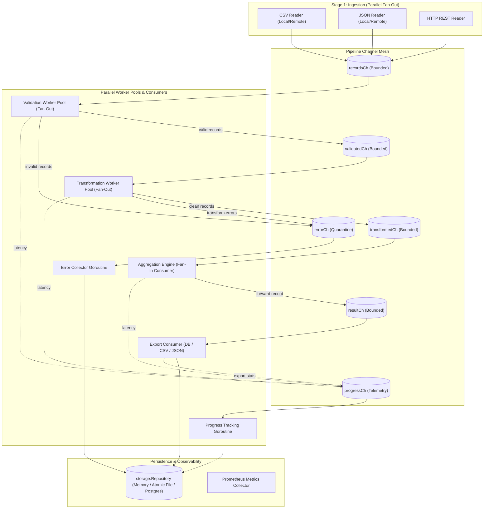

# Concurrent Data Processing Pipeline (Go)

A robust, production-oriented, concurrent data processing engine and job management REST service implemented in idiomatic Go. It ingests data from heterogeneous sources (CSV files, JSON files, external HTTP APIs), validates and cleans records against schema and business rules, executes parallel transformations, calculates grouped analytical aggregations, and exports results to storage targets — all while supporting real-time progress tracking, error quarantine, cancellation, and automated tests.

---

## Key Highlights

- **Clean Architecture & Single Responsibility:** Decoupled packages with clear boundaries (`internal/ingestion/`, `internal/validation/`, `internal/transformation/`, `internal/aggregation/`, `internal/export/`, `internal/jobs/`, `internal/storage/`, `internal/pipeline/`, `internal/models/`, `internal/api/`, `internal/metrics/`, `internal/config/`).
- **Bounded Channels & Backpressure:** Pipeline stages communicate strictly via typed, bounded channels (`recordsCh` ➔ `validatedCh` ➔ `transformedCh` ➔ `resultCh`), preventing unbounded heap growth and providing natural backpressure on I/O.
- **Actor-Style Concurrency (Fan-Out / Fan-In):** Dedicated goroutines per ingestion source stream records in parallel; configurable worker pools parallelize CPU-bound validation and transformation; dedicated single-consumer goroutines handle aggregation, export, progress tracking, and error collection without lock contention.
- **Hierarchical Cooperative Cancellation:** Every pipeline job runs under a `context.Context` hierarchy with timeouts. Cancellation via `PATCH /api/v1/pipelines/:id/cancel` propagates instantly to disk readers, HTTP requests, and worker pool loops.
- **Centralized Error Quarantine:** Faulty or corrupted records are isolated with stage and field diagnostic metadata into a centralized error collection over `errorCh`. The pipeline continues processing valid rows without crashing.
- **Pluggable Persistence:** `storage.Repository` interface abstracts storage engines, providing thread-safe In-Memory and atomic crash-safe File implementations, ready for drop-in PostgreSQL migration.
- **Reliability & Observability Middleware:** Structured logging with standard library `log/slog`, panic recovery middleware, IP-based token-bucket rate limiting, and Prometheus metrics exposition (`/metrics`).
- **Zero External Dependencies:** Built 100% with the Go standard library for zero supply-chain CVE vulnerabilities, fast compilation, and lightweight footprint.
- **100% Race-Clean & Tested:** Unit and full end-to-end integration tests pass cleanly with `go test -race -count=1 ./...`.

---

## Architecture Overview



---

## Project Structure

```
data-processing-pipeline/
├── cmd/
│   └── server/
│       └── main.go                  # Dependency injection composition root & OS signal shutdown
├── internal/
│   ├── aggregation/
│   │   ├── aggregator.go            # Group-by count, sum, average aggregation engine
│   │   ├── aggregator_test.go       # Aggregation unit tests
│   │   └── types.go                 # Aggregator interfaces and state types
│   ├── api/
│   │   ├── middleware/
│   │   │   ├── logging.go           # Structured HTTP request logger (`log/slog`)
│   │   │   ├── middleware_test.go   # Middleware unit tests
│   │   │   ├── ratelimit.go         # Token-bucket rate limiter per client IP
│   │   │   └── recovery.go          # HTTP panic recovery middleware
│   │   ├── handler.go               # HTTP handlers for all 8 REST endpoints
│   │   ├── response.go              # Standard JSON response and error envelopes
│   │   ├── routes.go                # Route multiplexer and middleware decorators
│   │   ├── server.go                # Server lifecycle and configuration
│   │   ├── server_test.go           # REST API endpoint unit & mock tests
│   │   └── validation.go            # Job request specification validator
│   ├── config/
│   │   ├── config.go                # Strongly-typed configuration with environment overrides
│   │   └── config_test.go           # Configuration tests
│   ├── export/
│   │   ├── csv.go                   # Formatted CSV record writer
│   │   ├── exporter.go              # Exporter dispatcher and target coordinator
│   │   ├── exporter_test.go         # Exporter unit tests
│   │   └── json.go                  # Formatted JSON record writer
│   ├── ingestion/
│   │   ├── csv.go                   # Streaming CSV reader
│   │   ├── http.go                  # Context-aware HTTP client with custom headers
│   │   ├── json.go                  # Streaming JSON reader (arrays and objects)
│   │   ├── reader.go                # Unified multi-source stream dispatcher
│   │   ├── reader_test.go           # Ingestion unit and mock tests
│   │   └── types.go                 # Ingested item definition
│   ├── jobs/
│   │   ├── errors.go                # Domain error definitions (capacity, not found, conflicts)
│   │   ├── manager.go               # Job manager, active quotas, and async orchestration
│   │   ├── manager_test.go          # Job manager unit tests
│   │   └── service.go               # Progress, error querying, results, and cancellation logic
│   ├── metrics/
│   │   ├── collector.go             # Telemetry collector (counters, latencies, rates)
│   │   ├── metrics_test.go          # Metrics unit tests
│   │   └── prometheus.go            # Prometheus text format serializer
│   ├── models/
│   │   ├── config.go                # Config, Source, Rule, Aggregation, ExportTarget models
│   │   ├── job.go                   # Job struct and state models
│   │   ├── metrics.go               # Observability and Progress tracking models
│   │   ├── record.go                # Record map and RecordError definitions
│   │   └── status.go                # Job status constants (PENDING, RUNNING, COMPLETED, etc.)
│   ├── pipeline/
│   │   ├── orchestrator.go          # Full multi-stage channel mesh execution loop
│   │   ├── pipeline.go              # Pipeline struct constructor and interfaces
│   │   ├── pipeline_test.go         # Direct pipeline execution tests
│   │   └── worker.go                # Validation and transformation worker pools
│   └── storage/
│       ├── file.go                  # Atomic JSON file repository (crash-safe snapshot storage)
│       ├── memory.go                # Thread-safe in-memory repository (testing)
│       ├── repository.go            # Storage interface definition
│       ├── storage_test.go          # Storage persistence tests
│       └── store.go                 # Backward-compatibility storage adapter
├── test/
│   └── pipeline_integration_test.go # End-to-end integration tests (CSV + JSON + HTTP)
├── configs/
│   └── default.json                 # Sample server configuration
├── docs/
│   ├── design-report.md             # <= 1-page design report (architecture & concurrency model)
│   ├── openapi.json                 # OpenAPI 3.0.3 specification for all REST endpoints
│   └── production-readiness.md      # Detailed comparison: code quality vs. cloud production readiness
├── samples/
│   ├── input.csv                    # Sample CSV input file
│   ├── input.json                   # Sample JSON input file
│   ├── job.json                     # Complete sample pipeline job specification
│   ├── mixed_job.json               # Sample mixed job (CSV file + JSON file + HTTP REST API)
│   └── responses/                   # Example API JSON responses
│       ├── cancel_pipeline.json     # Response for PATCH /api/v1/pipelines/:id/cancel
│       ├── create_pipeline.json     # Response for POST /api/v1/pipelines
│       ├── get_pipeline.json        # Response for GET /api/v1/pipelines/:id
│       ├── list_pipelines.json      # Response for GET /api/v1/pipelines
│       ├── pipeline_errors.json     # Response for GET /api/v1/pipelines/:id/errors
│       ├── pipeline_progress.json   # Response for GET /api/v1/pipelines/:id/progress
│       └── pipeline_results.json    # Response for GET /api/v1/pipelines/:id/results
├── .githooks/                       # Native git hooks (pre-commit, commit-msg)
│   ├── commit-msg                   # Conventional Commits format validator
│   └── pre-commit                   # Formatter (gofmt/gofumpt), vet, and race tests runner
├── .golangci.yml                    # golangci-lint linter configuration (ESLint equivalent)
├── .lefthook.yml                    # Lefthook git hook configuration (Husky equivalent)
├── Dockerfile                       # Multi-stage distroless container build
├── docker-compose.yml               # Container orchestration with volumes & healthchecks
├── Makefile                         # Automation targets for build, test, race, vet, and run
└── go.mod                           # Go module definition
```

---

## Quickstart

### Prerequisites
- Go 1.23+ (or Docker)

### Run with Makefile
```bash
# Run unit and integration tests with Go race detector
make race

# Build binary
make build

# Run server locally
make run
```

### Environment Variables
| Variable | Default | Description |
| :--- | :--- | :--- |
| `ADDR` | `:8080` | Server listening address |
| `DATA_DIR` | `data` | Directory for persistent state storage |
| `EXPORT_DIR` | `exports` | Directory for generated CSV/JSON export files |
| `MAX_ACTIVE_JOBS` | `10` | Maximum number of concurrent active jobs |
| `RATE_LIMIT_RPS` | `50.0` | Token bucket refill rate per second per IP |
| `RATE_LIMIT_BURST`| `100` | Maximum token bucket burst capacity per IP |
| `DEFAULT_TIMEOUT_SECONDS` | `300` | Default job execution timeout in seconds |

---

## API Reference

| Method | Endpoint | Status | Description | Sample Response |
| :--- | :--- | :--- | :--- | :--- |
| `POST` | `/api/v1/pipelines` | `202 Accepted` | Submit a new pipeline job | [create_pipeline.json](samples/responses/create_pipeline.json) |
| `GET` | `/api/v1/pipelines` | `200 OK` | List all pipeline jobs | [list_pipelines.json](samples/responses/list_pipelines.json) |
| `GET` | `/api/v1/pipelines/:id` | `200 OK` | Get job configuration, status, and summary | [get_pipeline.json](samples/responses/get_pipeline.json) |
| `GET` | `/api/v1/pipelines/:id/progress` | `200 OK` | Poll progress, processed counts, and stage latency | [pipeline_progress.json](samples/responses/pipeline_progress.json) |
| `GET` | `/api/v1/pipelines/:id/results` | `200 OK` | Retrieve processed records, aggregates, and exports | [pipeline_results.json](samples/responses/pipeline_results.json) |
| `GET` | `/api/v1/pipelines/:id/errors` | `200 OK` | Retrieve quarantined errors and failed records | [pipeline_errors.json](samples/responses/pipeline_errors.json) |
| `PATCH` | `/api/v1/pipelines/:id/cancel` | `202 Accepted` | Cancel an actively running pipeline job | [cancel_pipeline.json](samples/responses/cancel_pipeline.json) |
| `DELETE` | `/api/v1/pipelines/:id` | `204 No Content`| Delete a completed/failed job and its artifacts | — |
| `GET` | `/docs` | `200 OK` | Interactive Swagger UI API documentation | HTML |
| `GET` | `/docs/openapi.json` | `200 OK` | OpenAPI 3.0.3 specification in JSON | [openapi.json](docs/openapi.json) |
| `GET` | `/metrics` | `200 OK` | Prometheus text metrics exposition | Plain text |
| `GET` | `/healthz` | `200 OK` | Health check endpoint | `{"status":"ok"}` |

---

## Example Usage

### 1. Submit a Standard Pipeline Job
```bash
curl -sS -X POST http://localhost:8080/api/v1/pipelines \
  -H "Content-Type: application/json" \
  -d @samples/job.json
```

**Response (`202 Accepted`):**
```json
{
  "id": "20261103T100000.000000000",
  "status": "PENDING",
  "created_at": "2026-11-03T10:00:00Z"
}
```

### 2. Submit a Mixed Source Job (CSV + JSON + External HTTP API)
```bash
curl -sS -X POST http://localhost:8080/api/v1/pipelines \
  -H "Content-Type: application/json" \
  -d @samples/mixed_job.json
```

### 3. Poll Real-Time Progress & Latencies
```bash
curl -sS http://localhost:8080/api/v1/pipelines/<JOB_ID>/progress
```

**Response (`200 OK`):**
```json
{
  "job_id": "20261103T100000.000000000",
  "status": "RUNNING",
  "percent_complete": 85.71,
  "processed": 6,
  "discovered": 7,
  "pending": 1,
  "valid": 6,
  "rejected": 1,
  "error_count": 1,
  "records_per_second": 3.82,
  "stage_latency_ns": {
    "validation": 420000,
    "transformation": 310000,
    "aggregation": 152000
  }
}
```

### 4. Retrieve Computed Aggregations & Export Details
```bash
curl -sS http://localhost:8080/api/v1/pipelines/<JOB_ID>/results
```

**Response (`200 OK`):**
```json
{
  "job_id": "20261103T100000.000000000",
  "status": "COMPLETED",
  "records": [
    {"department": "engineering", "name": "Alice", "salary": 120000},
    {"department": "sales", "name": "Bob", "salary": 90000}
  ],
  "aggregations": {
    "employee_count": {"engineering": 3, "sales": 3},
    "salary_total": {"engineering": 365000, "sales": 265000},
    "salary_average": {"engineering": 121666.67, "sales": 88333.33}
  },
  "export_path": "exports/employees.json"
}
```

### 5. Inspect Quarantined Errors
```bash
curl -sS http://localhost:8080/api/v1/pipelines/<JOB_ID>/errors
```

**Response (`200 OK`):**
```json
{
  "job_id": "20261103T100000.000000000",
  "errors": [
    {
      "source": "employees-csv",
      "index": 4,
      "stage": "validation",
      "message": "field \"salary\": invalid number \"invalid\"",
      "record": {
        "department": "Engineering",
        "name": "Eve",
        "salary": "invalid"
      },
      "at": "2026-11-03T10:00:00.120Z"
    }
  ]
}
```

### 6. Cancel a Running Job
```bash
curl -sS -X PATCH http://localhost:8080/api/v1/pipelines/<JOB_ID>/cancel
```

---

## Testing & Quality Assurance

```bash
# Run unit and integration tests across all packages
go test -v ./...

# Verify concurrency safety with Go's race detector
go test -race -count=1 ./...

# Static analysis
go vet ./...

# Full check: format, static analysis, race detector
make check
```

---

## Git Hooks & Quality Automation

This repository includes a native Go git tooling setup (the Go equivalent of Husky, Prettier, ESLint, and commitlint):

| Standard Tooling | Go Equivalent in this Repo | Configuration File |
| :--- | :--- | :--- |
| **Husky** | Native Git Hooks / **`lefthook`** | `.githooks/` & `.lefthook.yml` |
| **Prettier** | **`gofmt`** / **`gofumpt`** | Executed in pre-commit hook & `make fmt` |
| **ESLint** | **`golangci-lint`** / `go vet` | `.golangci.yml` & `make lint` |
| **commitlint** | Conventional Commits hook | `.githooks/commit-msg` |

### Activating Git Hooks
To activate automated checks for every commit:
```bash
make hooks
```
This configures `git config core.hooksPath .githooks`, which automatically:
1. **`pre-commit`**: Formats staged `.go` files with `gofmt`/`gofumpt`, runs `go vet`, runs `golangci-lint` (if installed), and verifies unit tests.
2. **`commit-msg`**: Validates that all commit messages follow Conventional Commits format (`feat:`, `fix:`, `refactor:`, `test:`, `docs:`, etc.).

---

## Documentation

- **[Design Report (<= 1 Page)](docs/design-report.md):** Executive summary covering system architecture, goroutine lifecycle, fan-out/fan-in concurrency model, context hierarchy, and engineering trade-offs.
- **[Production Readiness Analysis](docs/production-readiness.md):** In-depth technical roadmap contrasting current codebase quality against enterprise cloud requirements (PostgreSQL, S3/GCS object storage, durable messaging queues, OpenTelemetry, quota management, CI security scanning).
