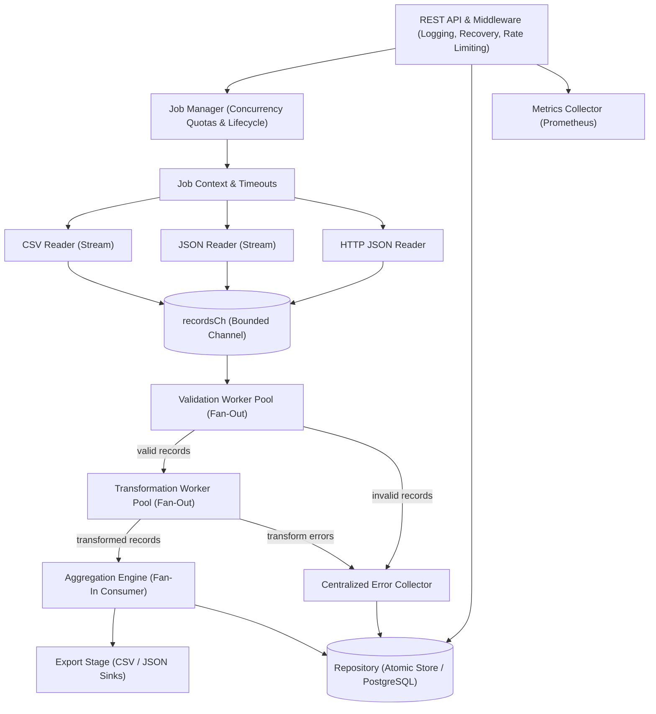

# Concurrent Data Processing Pipeline (Go)

A production-oriented, concurrent data processing engine and job management service implemented in idiomatic Go. It ingests data from heterogeneous sources (CSV, JSON, external HTTP APIs), validates and cleans records, executes parallel transformations, calculates grouped analytical aggregations, and persists results and observability metrics.

## Key Highlights

- **Modular Architecture:** Clean separation of concerns across `cmd/server/`, `internal/api/`, `internal/config/`, `internal/models/`, `internal/metrics/`, `internal/pipeline/stages/`, `internal/repository/`, and `internal/sources/`.
- **Bounded Channels & Backpressure:** Pipeline stages are connected by typed, bounded channels, preventing unbounded heap consumption.
- **Controlled Fan-Out / Fan-In:** Dedicated goroutines per ingestion source, parameterized worker pools for CPU-intensive validation and transformation, and a single fan-in consumer for deterministic aggregation without lock contention.
- **Context-Aware Cancellation:** Context cancellation and timeouts propagate across all file readers, external HTTP requests, and worker pool loops.
- **Fault-Tolerant Error Quarantine:** Invalid records are quarantined into a centralized error collection with full payload and stage diagnostics, allowing valid records to proceed.
- **Interface-Driven Persistence:** Abstraction via `repository.Repository` decouples the domain from storage engines (includes In-Memory and Atomic File implementations, drop-in ready for PostgreSQL).
- **Security & Reliability Middleware:** Structured logging (`log/slog`), panic recovery, and IP-based token bucket rate limiting.
- **Zero External Runtime Dependencies:** Implemented purely with the Go standard library for zero vulnerabilities and instant compilation.
- **Race Detector Clean:** 100% verified with `go test -race -count=1 ./...`.

---

## Architecture Overview



---

## Project Structure

```
data-processing-pipeline/
├── cmd/
│   └── server/
│       └── main.go                  # Application entrypoint & OS signal graceful shutdown
├── internal/
│   ├── api/
│   │   ├── middleware/
│   │   │   ├── logging.go           # Structured HTTP request logger (`log/slog`)
│   │   │   ├── recovery.go          # HTTP panic recovery middleware
│   │   │   └── ratelimit.go         # Token-bucket rate limiter per client IP
│   │   ├── collection.go            # Handlers for POST /api/v1/pipelines and GET list
│   │   ├── item.go                  # Handlers for /:id, /progress, /results, /errors, /cancel
│   │   ├── metrics.go               # Prometheus metrics exposition handler
│   │   ├── routes.go                # HTTP router and middleware chain setup
│   │   ├── server.go                # Server initialization and lifecycle
│   │   └── validation.go            # Request body decoding and JSON response helpers
│   ├── config/
│   │   └── config.go                # Strongly-typed configuration with environment overrides
│   ├── metrics/
│   │   ├── collector.go             # Global telemetry collector (jobs, records, errors, latency)
│   │   └── prometheus.go            # Prometheus text exposition formatter
│   ├── models/
│   │   └── types.go                 # Core domain definitions: Job, Config, Rule, Record, Metrics
│   ├── pipeline/
│   │   ├── stages/
│   │   │   ├── validation.go        # Schema and business rule validation stage
│   │   │   ├── transformation.go    # Data normalization, scaling, and enrichment stage
│   │   │   ├── aggregation.go       # Group-by count, sum, and average aggregation engine
│   │   │   └── export.go            # Formatted CSV and JSON persistence stage
│   │   ├── workers.go               # Fan-out worker pool primitives
│   │   ├── executor.go              # Pipeline execution graph orchestrator
│   │   └── manager.go               # Job manager with active concurrency quotas and cancellation
│   ├── repository/
│   │   ├── repository.go            # Persistence interface specification
│   │   ├── memory.go                # Thread-safe in-memory repository (fast testing)
│   │   └── file.go                  # Atomic JSON snapshot repository (crash-safe file storage)
│   └── sources/
│       ├── csv.go                   # Streaming CSV reader
│       ├── json.go                  # Streaming JSON reader (arrays and single objects)
│       ├── http.go                  # Context-aware HTTP client with custom headers
│       └── read.go                  # Unified source reader dispatcher
├── configs/
│   └── default.json                 # Sample runtime configuration
├── docs/
│   ├── design-report.md             # 1-page design report (architecture & concurrency model)
│   └── production-readiness.md      # Detailed comparison: code quality vs. cloud production readiness
├── samples/
│   ├── input.csv                    # Sample CSV input data
│   ├── input.json                   # Sample JSON input data
│   └── job.json                     # Complete sample pipeline job specification
├── Dockerfile                       # Multi-stage distroless container build
├── docker-compose.yml               # Container orchestration with volumes & healthchecks
├── Makefile                         # Automation targets for build, test, race, lint, and run
└── go.mod                           # Go module definition
```

---

## Quickstart

### Prerequisites
- Go 1.23+ (or Docker)

### Run with Makefile
```bash
# Run test suite with Go race detector
make race

# Build binary
make build

# Run server locally
make run
```

### Environment Variables
| Variable | Default | Purpose |
| :--- | :--- | :--- |
| `ADDR` | `:8080` | Server listening address |
| `DATA_DIR` | `data` | Directory for persistent state storage |
| `EXPORT_DIR` | `exports` | Directory for generated CSV/JSON export files |
| `MAX_ACTIVE_JOBS` | `10` | Maximum number of concurrent jobs permitted |
| `RATE_LIMIT_RPS` | `50.0` | Token bucket refill rate per second per IP |
| `RATE_LIMIT_BURST`| `100` | Maximum burst capacity per IP |

---

## API Reference

| Method | Endpoint | Description |
| :--- | :--- | :--- |
| `POST` | `/api/v1/pipelines` | Submit a new pipeline job specification |
| `GET` | `/api/v1/pipelines` | List all pipeline jobs |
| `GET` | `/api/v1/pipelines/:id` | Get job configuration, status, and summary metrics |
| `GET` | `/api/v1/pipelines/:id/progress` | Poll real-time progress, processed counts, and stage latency |
| `GET` | `/api/v1/pipelines/:id/results` | Retrieve processed records, computed aggregates, and export link |
| `GET` | `/api/v1/pipelines/:id/errors` | Retrieve quarantined errors and failed record details |
| `PATCH` | `/api/v1/pipelines/:id/cancel` | Cancel an actively running pipeline job |
| `DELETE` | `/api/v1/pipelines/:id` | Delete a completed/failed job and its export artifacts |
| `GET` | `/metrics` | Prometheus text metrics |
| `GET` | `/healthz` | Health check endpoint |

---

## Example Usage

### 1. Submit a Job
```bash
curl -sS -X POST http://localhost:8080/api/v1/pipelines \
  -H "Content-Type: application/json" \
  -d @samples/job.json
```

### 2. Poll Progress
```bash
curl -sS http://localhost:8080/api/v1/pipelines/<JOB_ID>/progress
```

### 3. Retrieve Computed Aggregations and Results
```bash
curl -sS http://localhost:8080/api/v1/pipelines/<JOB_ID>/results
```

### 4. Inspect Quarantined Errors
```bash
curl -sS http://localhost:8080/api/v1/pipelines/<JOB_ID>/errors
```

---

## Testing & Quality Assurance

```bash
# Run unit and integration tests across all packages
go test -v ./...

# Verify concurrency safety with the race detector
go test -race -count=1 ./...

# Static analysis
go vet ./...
```

For an in-depth analysis of how this codebase bridges into enterprise multi-node cloud environments, see [docs/production-readiness.md](file:///Users/anandk/Projects/data-processing-pipeline/docs/production-readiness.md).
